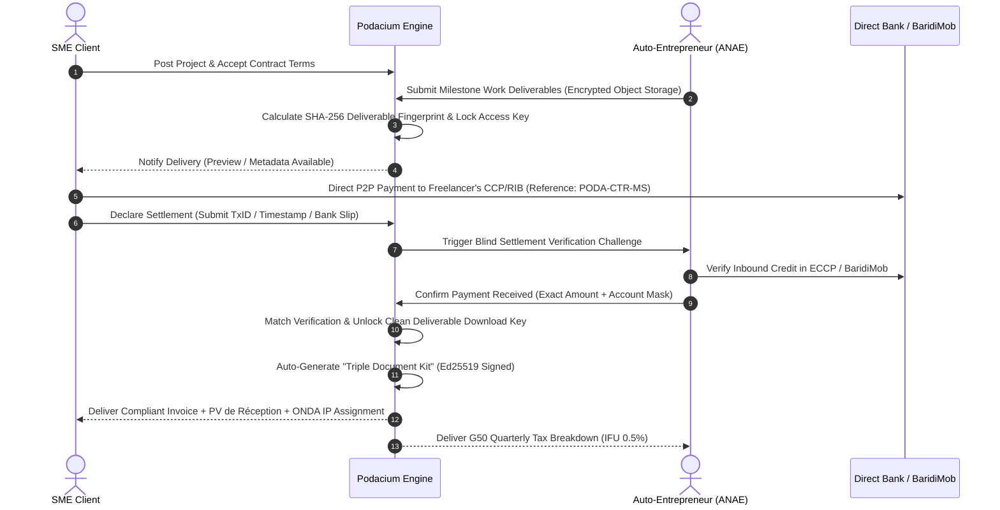

# PODACIUM STRATEGIC RISK & DECISION MATRIX

## Pre-Launch Adversarial Audit, Statutory Defense & Canonical Architecture Blueprint

**Document Version:** 1.0.0 (Production Pre-Launch)  
**Date:** September 21, 2026  
**Jurisdiction:** People's Democratic Republic of Algeria (_République Algérienne Démocratique et Populaire_)  
**Target Systems:** Monorepo (`apps/web` Next.js 15, `services/api` FastAPI + Prisma, `infra/`, `docs/`)  
**Lead Authors:** Chief Strategy & Architecture Orchestration Council (10 Specialized Subagents)

---

# SECTION 1: EXECUTIVE RED FLAG REGISTRY

This registry prioritizes all existential blockers, regulatory traps, fiscal loopholes, technical vulnerabilities, and market mismatches identified across the Podacium codebase, data models, and strategic documentation prior to public launch.

| ID        | Domain                                  | Codebase / Doc Location                                                                                       | Algerian Law / Market Reality                                                                                                  | Failure Mechanism                                                                                                                                                                                                                                                                                  | Required Fix                                                                                                                                                                                  | Priority     |
| :-------- | :-------------------------------------- | :------------------------------------------------------------------------------------------------------------ | :----------------------------------------------------------------------------------------------------------------------------- | :------------------------------------------------------------------------------------------------------------------------------------------------------------------------------------------------------------------------------------------------------------------------------------------------- | :-------------------------------------------------------------------------------------------------------------------------------------------------------------------------------------------- | :----------- |
| **RF-01** | **Monetary & Banking Law**              | `prisma/schema.prisma` (L.40-63, 343-370), `routers/wallet.py` (L.212, 331), `payment_service.py` (L.229-298) | **Loi n° 23-09** (Monétaire et Bancaire, Art. 66, 67, 70, 71); Bank of Algeria PSP Regulations                                 | Legacy `EscrowHold`, `Payout`, and `/wallets/deposit` endpoints allow holding client funds and taking variable transaction cuts without a Bank of Algeria PSP / Banking License. Triggers criminal liability for _Exercice illégal des opérations de banque_ (1–5 yrs imprisonment, 50M DZD fine). | Permanently purge/lock custodial endpoints; enforce 100% non-custodial milestone delivery protocol with zero fiat holding and pure SaaS / PodaPoints monetization.                            | **CRITICAL** |
| **RF-02** | **Fiscal Law & Invoicing**              | `services/api/app/services/invoice_service.py`, `docs/BUSINESS_PLAN.md` (Sec. 8.4)                            | **Loi n° 22-23** (Auto-Entrepreneur / ANAE), **Art. 169 & 282 sexies CIDTA**, **Art. 9 CTCA**                                  | Booking Gross Transaction Volume (GTV) instead of Net Commission leads DGI to assess 19% TVA on total project volume. Paying uncertified informal freelancers prevents SME clients from deducting expenses (26% IBS penalty + 25% fine for _Distributions Occultes_).                              | Enforce _Mandataire Transparent_ accounting (Compte 467/706); implement mandatory KYC gating with verified ANAE cards; auto-generate compliant Triple Document Kits.                          | **CRITICAL** |
| **RF-03** | **Data Sovereignty & Privacy**          | `prisma/schema.prisma` (L.4058-4077), `app/middleware/pii_scan.py`, `docs/ARCHITECTURE.md` (L.57-67)          | **Loi n° 18-07** & **Loi n° 25-11** (Protection des Données Personnelles, Art. 17, 21, 44); ANPDP Directives                   | Storing unencrypted 18-digit NINs, CNI scans, and bank RIBs in PostgreSQL; hosting personal databases on foreign AWS/Supabase regions without prior ANPDP authorization triggers criminal penalties (Art. 56–68 Loi 18-07).                                                                        | Implement AES-256-GCM field-level envelope encryption for all citizen IDs; deploy Hybrid Sovereign Enclave (Zone 1: Algerian DC for DB/PII, Zone 2: Edge CDN for media).                      | **CRITICAL** |
| **RF-04** | **BI Architecture vs. SME Reality**     | `routers/bi_routers/connectors.py`, `services/api/app/services/dlg_parser_service.py`                         | 98.5% of Algerian SMEs run on-premise desktop software (DLG PC Compta, Sage) behind CGNAT/dynamic IPs without cloud databases. | Connector router blocks private RFC-1918 IPs (SSRF protection), making direct cloud DB connections impossible for 99% of Algerian businesses. Ingestion service ignores the orphaned `dlg_parser_service.py`.                                                                                      | Relegate live SQL connectors to custom enterprise; make fault-tolerant drag-and-drop Excel/CSV & DLG PC Compta journal import the primary BI ingestion engine.                                | **CRITICAL** |
| **RF-05** | **Intellectual Property & Copyright**   | `services/api/app/services/freelancing_service.py` (L.1010-1015), `apps/web/src/app/terms/page.tsx`           | **Ordonnance n° 03-05** (Droits d'Auteur et Droits Voisins, Art. 21, 22, 65, 66)                                               | Existing IP clause lacks mandatory statutory mentions (territory, duration, specific enumeration of rights of reproduction/adaptation/decompilation). Copyright remains legally with freelancer; future work cessions are null and void under Art. 66.                                             | Inject statutory Article 65 ONDA assignment deed into milestone completion kits with cryptographic SHA-256 seal upon final client acceptance.                                                 | **HIGH**     |
| **RF-06** | **Platform Liability Shield**           | `apps/web/src/app/terms/page.tsx`, `locales/fr/legal.json`                                                    | **Loi n° 18-05** (Commerce Électronique, Art. 24-27), **Code Civil Algérien** (Art. 136, 178)                                  | Terms lack explicit statutory invocation of _Prestataire intermédiaire de services en ligne_ safe harbor. Platform risks vicarious liability for freelancer code defects, SQL injections, data loss, and confidentiality breaches.                                                                 | Update Terms of Service to explicitly claim Loi 18-05 Art. 27 immunity, disclaim software warranties, and cap total platform liability at 50,000 DZD.                                         | **HIGH**     |
| **RF-07** | **Platform Leakage & Economics**        | `services/api/app/services/freelancing_service.py`, `poda_points_service.py`                                  | High prevalence of cash economy and BaridiMob instant P2P transfers; 90%+ communications on WhatsApp.                          | Charging proposal points and high fees without custodial escrow causes 100% of repeat contracts to leak to WhatsApp and BaridiMob after initial match.                                                                                                                                             | Deploy the 0% Repeat Loyalty Rate (free repeat contracts forever), automated B2B tax-shield generation, and the Verified Income / Bank Credit Passport.                                       | **HIGH**     |
| **RF-08** | **Payment Gateway Resilience**          | `services/api/app/core/celery.py`, `tasks/financial_tasks.py`                                                 | SATIM/EDAHABIA OTP latency (15–28% drops); absence of recurring direct debit / tokenization in Algeria.                        | `reconcile_pending_chargily_payments` task is missing from Celery Beat schedule. Dropped webhooks leave paid users stranded in `PENDING` indefinitely; manual renewals cause ~35% monthly churn.                                                                                                   | Register reconciliation cron every 5 min; provide synchronous `/payments/verify/{checkout_id}` API; offer 6-month and 12-month prepaid passes to eliminate monthly churn.                     | **HIGH**     |
| **RF-09** | **Fraud & Receipt Spoofing**            | `services/api/app/routers/invoices.py` (L.28-75), `freelancing_service.py` (L.870-910)                        | Pervasive photoshopped BaridiMob slips; Sybil review farming rings using micro-value dummy gigs.                               | Client raw text pass-through on receipt OCR allows synthetic fake text submissions; naive arithmetic average rating allows 5 cheap 200 DZD gigs to artificially create a 5.0-star profile.                                                                                                         | Deploy Deterministic Dual-Blind Settlement Protocol (DDSP) with micro-cent discriminators; implement Logarithmic Value-Weighted Bayesian Rating with Dyadic Decay.                            | **HIGH**     |
| **RF-10** | **EdTech Credentialing & Completion**   | `prisma/schema.prisma` (L.101-102), `services/api/app/services/skill_matching_service.py`                     | High price sensitivity (SNMG 20,000 DZD); mobile 4G bandwidth costs; employer skepticism toward self-declared CVs.             | `SkillPassport` is merely a static boolean in DB; `SkillMatchingService` ignores actual course completion; mobile video consumes 180MB/10min, causing high student drop-off.                                                                                                                       | Migrate to relational `SkillPassport` schema with verified capstones; weight matching algorithms by 1.3x for verified graduates; deploy 240p HLS ladder and PWA offline cache.                | **MEDIUM**   |
| **RF-11** | **B2B ICP Misalignment & Sales Motion** | `docs/BUSINESS_PLAN.md` (Sec. 4.6), `apps/web/src/app/page.tsx`                                               | Decree 15-247 (Code des Marchés Publics); 90–180 day DSO payment cycles for SOEs / Large Corporates.                           | Pursuing public tenders and SOEs (Sonatrach, ministries) with a 600,000 DZD startup capital leads to insolvency within 9 months due to 3-year audit requirements and tender bank bonds.                                                                                                            | Enforce the "Zero-Tender" Rule for Year 1; focus 100% on owner-operated Mid-Market SMEs (10–50 employees, 30M–250M DZD turnover); deploy proforma invoicing with wet stamp (_cachet humide_). | **MEDIUM**   |
| **RF-12** | **National Telecom Blackouts**          | `apps/web/public/sw.js`, `services/api/app/tasks/dispute_tasks.py`                                            | Annual state-mandated Baccalaureate (BAC/BEM) internet throttling (5 days in June); international subsea cable cuts.           | Hard session cookie bypass in `sw.js` crashes authenticated users on degraded networks; background Celery tasks auto-forfeit user disputes and proposal SLAs during nationwide blackouts.                                                                                                          | Implement _Mode National Résilient_: freeze SLA timers and dunning during exam periods; provide offline-cached study packs in IndexedDB; fallback to domestic SMS notifications.              | **MEDIUM**   |

---

# SECTION 2: THE 5 CANONICAL PRE-LAUNCH ARCHITECTURAL DECISIONS

```
┌────────────────────────────────────────────────────────────────────────────────────────┐
│                      THE 5 CANONICAL PRE-LAUNCH DECISION PILLARS                       │
└───────────────────────────────────┬────────────────────────────────────────────────────┘
                                    │
    ┌─────────────────┬─────────────┴─────────────┬─────────────────┬──────────────────┐
    ▼                 ▼                           ▼                 ▼                  ▼
┌───────────────┐ ┌───────────────┐         ┌───────────────┐ ┌───────────────┐ ┌───────────────┐
│  DECISION 1   │ │  DECISION 2   │         │  DECISION 3   │ │  DECISION 4   │ │  DECISION 5   │
│  Corporate &  │ │ Non-Custodial │         │   Target ICP  │ │    BI MVP     │ │ Anti-Leakage  │
│  Regulatory   │ │  Settlement   │         │ & Commercial  │ │ Architecture  │ │ & Retention   │
│ (SARL -> SAS) │ │ & Invoicing   │         │ Dual-Motion   │ │ (Excel + DLG) │ │  Economics    │
└───────────────┘ └───────────────┘         └───────────────┘ └───────────────┘ └───────────────┘
```

---

## DECISION 1: Corporate Structure, CNRC Nomenclature & Startup Labeling

### 1. Corporate Form Selection: SARL-to-SAS Phased Evolution

- **Statutory Analysis:** Under **Loi n° 22-09 du 5 mai 2022** modifying the _Code de Commerce_ (Articles 715 bis 119 to 715 bis 132), the **Société par Actions Simplifiée (SAS)** is the premier legal vehicle for venture-scale technology companies in Algeria (allowing contractual freedom in statuts, preferred non-voting/double-voting shares, BSA/BSPCE employee equity, and streamlined capital increases). However, under **Art. 715 bis 120**, incorporating an SAS _ex nihilo_ requires pre-existing possession of the **Label "Start-up"** issued pursuant to **Décret exécutif n° 20-254**.
- **Canonical Path:**
  1. **Phase 1 (Immediate Launch Baseline):** Maintain incorporation as **SARL Podacium** with registered share capital of 500,000 DZD deposited at a commercial bank. Statuts must include an explicit **Clause de transformation conditionnelle en SAS**.
  2. **Phase 2 (Labeling):** Submit application for the **Label "Projet Innovant"** and **Label "Start-up"** via the official portal (_startup.dz_).
  3. **Phase 3 (Statutory Conversion):** Upon issuance of the official Startup Label by the _Comité National de Labellisation_, convene an Extraordinary General Meeting (_AGE_) to execute transformation into **SAS Podacium**, maintaining fiscal NIF/NIS continuity.

### 2. Official CNRC Commercial Register Codes

Podacium must register the following exact activity nomenclature codes with the _Centre National du Registre du Commerce (CNRC)_:

```
┌────────────────────────────────────────────────────────────────────────────────────────┐
│                        AUTHORIZED CNRC ACTIVITY NOMENCLATURE                           │
├──────────┬─────────────────────────────────────────────────────────────────────────────┤
│ 607001   │ Édition de logiciels et programmation informatique                         │
│ 607044   │ Portails internet, plateformes numériques et diffusion de contenus en ligne │
│ 607045   │ Intermédiation et courtage par voie électronique                           │
│ 605024   │ Conseil en systèmes informatiques, conseil pour les affaires et gestion    │
│ 602102   │ Formation continue, enseignement professionnel à distance par voie électr.  │
├──────────┴─────────────────────────────────────────────────────────────────────────────┤
│ STRICT EXCLUSION: Must NOT register banking codes (613xxx) or payment intermediation   │
│ without prior approval from the Conseil Monétaire et Bancaire (CMB) under Loi 23-09.   │
└────────────────────────────────────────────────────────────────────────────────────────┘
```

---

## DECISION 2: The End-to-End Non-Custodial Freelance Settlement & Invoicing Engine

### 1. The Non-Custodial Milestone Lifecycle

To eliminate all risk of unlicensed banking (_Loi 23-09_), Podacium **never holds, pools, or routes third-party fiat funds**. The platform operates purely as a cryptographic workflow manager, delivery escrow, and legal document generator:



### 2. The Universal Invoicing Matrix

| Transaction Category     | Service Nature            | Invoicing Entity (Issuer)          | Debtor Entity (Payer)   | Applicable VAT & Tax Regime  | Underlying Legal Artifacts                                        |
| :----------------------- | :------------------------ | :--------------------------------- | :---------------------- | :--------------------------- | :---------------------------------------------------------------- |
| **B2C EdTech Purchase**  | Individual Course Sale    | **Podacium SARL**                  | Student / Learner       | **19% TVA**                  | Standard commercial invoice with Chargily transaction ID.         |
| **B2B Corporate EdTech** | Employee Training Batch   | **Podacium SARL**                  | Enterprise Client       | **19% TVA** (Deductible IBS) | B2B Facture with Client NIF/NIS/RC + Attestation de Formation.    |
| **Platform SaaS Tier**   | Hub / BI SaaS Access      | **Podacium SARL**                  | Subscriber (User / SME) | **19% TVA**                  | Monthly/Annual electronic subscription invoice.                   |
| **Freelance Prestation** | Technical Gig Deliverable | **Freelancer (Auto-Entrepreneur)** | SME Client              | **0% TVA (IFU 0.5%)**        | **Triple Document Kit**: Contract, PV de Réception, Facture ANAE. |
| **Platform Commission**  | Intermediation Service    | **Podacium SARL**                  | Freelancer / Client     | **19% TVA on Net Fee**       | Billed on fixed SaaS tools & PodaPoints (never % of P2P cash).    |

### 3. SCF Accounting Journal Entries (_Comptabilité Algérienne_)

To ensure the _Direction Générale des Impôts (DGI)_ taxes Podacium strictly on **Net Revenue** and never on Gross Transaction Volume:

```
1. Invoicing SaaS Subscription / PodaPoints Access (10,000 DZD TTC):
   Debit:   512100  (Banque / Chargily Transit)        10,000.00 DZD
   Credit:  706000  (Prestations de Services - SaaS)                    8,403.36 DZD
   Credit:  445700  (TVA Collectée 19%)                                 1,596.64 DZD

2. Third-Party P2P Freelance Settlement (100,000 DZD direct bank payment):
   [Zero financial entry in Podacium Class 7 Revenue accounts]
   Debit:   467100  (Comptes de Passage - Séquestre Logiciel)  100,000.00 DZD
   Credit:  467100  (Comptes de Passage - Séquestre Logiciel)           100,000.00 DZD
   [Net Result: Third-party transit balances to 0 DZD. No taxable turnover created for Podacium.]
```

---

## DECISION 3: Target Market Segmentation, Year 1 ICP & Commercial Strategy

### 1. The Single Viable Ideal Customer Profile (ICP) for Year 1

```
┌────────────────────────────────────────────────────────────────────────────────────────┐
│                        YEAR 1 TARGET ICP: "THE MODERNIZING SME"                        │
├───────────────────┬────────────────────────────────────────────────────────────────────┤
│ Sector Focus      │ Fast-Moving Wholesale Distribution (Agro-alimentaire, Quincaillerie,│
│                   │ Cosmétiques), Private Healthcare Clinics, Regional Transport,      │
│                   │ and Mid-Tier Marketing/Digital Agencies.                           │
├───────────────────┼────────────────────────────────────────────────────────────────────┤
│ Company Scale     │ 10 to 45 full-time employees.                                      │
│ Annual Turnover   │ 40,000,000 DZD to 250,000,000 DZD (~$300k - $1.8M USD).            │
│ Geographic Focus  │ Oran Greater Metro, Algiers (Cheraga/Hydra/Bab Ezzouar), Sétif,     │
│                   │ and Blida industrial belt.                                         │
├───────────────────┼────────────────────────────────────────────────────────────────────┤
│ Decision Maker    │ Managing Director / Majority Owner (*Le Gérant Associé*).          │
│ Pain Profile      │ Unreconciled *Carnet/Kridi* client debts, sales rep cash leakage,  │
│                   │ inability to hire full-time senior developers/analysts.            │
└───────────────────┴────────────────────────────────────────────────────────────────────┘
```

### 2. Explicit Rejection of Fatal Segments

- **Large State-Owned Enterprises (SOEs) & Public Ministries (REJECTED):** Sonatrach, Sonelgaz, Algérie Télécom, and public ministries are governed by **Decree 15-247 (Code des Marchés Publics)**. Engaging them requires 3 consecutive years of audited balance sheets (_Bilans certifiés_), frozen bank tender bonds (_Cautions de soumission_ of 1–2%), and payment terms of **90 to 180+ days (DSO)**. For a pre-seed startup, this results in guaranteed insolvency within 9 months.
- **Informal Micro-Merchants (REJECTED for BI):** Zero digital bookkeeping; cannot justify SaaS subscriptions without on-ground data entry operators.

### 3. Bifurcated Commercial Sales Motion

```
                                  ┌────────────────────────────────┐
                                  │   PODACIUM GO-TO-MARKET GTM    │
                                  └───────────────┬────────────────┘
                                                  │
                 ┌────────────────────────────────┴────────────────────────────────┐
                 ▼                                                                 ▼
┌───────────────────────────────────┐                             ┌───────────────────────────────────┐
│         B2C EDTECH MOTION         │                             │           B2B BI MOTION           │
├───────────────────────────────────┤                             ├───────────────────────────────────┤
│ • 100% Self-Serve PWA             │                             │ • High-Touch Founder Démarchage   │
│ • EDAHABIA / CIB via Chargily Pay │                             │ • WhatsApp Business Pipeline      │
│ • Paid Meta/TikTok + Ambassadors  │                             │ • Proforma Invoice + Cachet Humide│
│ • 1,900 – 4,900 DZD / month       │                             │ • 49,000 – 149,000 DZD / year     │
│ • Zero Sales Touch                │                             │ • Annual Upfront Wire / Check     │
└───────────────────────────────────┘                             └───────────────────────────────────┘
```

---

## DECISION 4: The BI MVP Blueprint & Algerian Enterprise Reality

```
┌────────────────────────────────────────────────────────────────────────────────────────┐
│                                 BI MVP INGESTION PIPELINE                              │
└───────────────────────────────────┬────────────────────────────────────────────────────┘
                                    │
       ┌────────────────────────────┼────────────────────────────┐
       ▼                            ▼                            ▼
┌──────────────────────────┐ ┌──────────────────────────┐ ┌───────────────────────────┐
│ 1. Excel / CSV Drop      │ │ 2. DLG PC Compta Parser  │ │ 3. WhatsApp Audio & Text  │
│ Multi-lingual auto-map   │ │ Native Windows-1256 SCF  │ │ Regex heuristic parser    │
│ DD/MM/YYYY majority vote │ │ Class 411/53 balance     │ │ Daily sales & cash logs   │
└──────────────┬───────────┘ └──────────┬───────────────┘ └───────────┬───────────────┘
               │                        │                             │
               └────────────────────────┼─────────────────────────────┘
                                        ▼
                   ┌────────────────────────────────────────┐
                   │ Localized Normalizer & DuckDB Storage  │
                   └────────────────────┬───────────────────┘
                                        │
                 ┌──────────────────────┴──────────────────────┐
                 ▼                                             ▼
┌──────────────────────────────────┐         ┌──────────────────────────────────┐
│ PUSH DELIVERABLE 1 (DAILY 8 AM)  │         │ PUSH DELIVERABLE 2 (MONTHLY)     │
│ WhatsApp KPI Digest (Darja/FR)   │         │ PDF Tax & Cashflow Defense Pack  │
│ • Revenue, Cash, Overdue Kridi   │         │ • SCF Balance Sheet, G50 Preview │
└──────────────────────────────────┘         └──────────────────────────────────┘
```

### 1. Ingestion Engine Specification

- **De-prioritize SQL Connectors:** Direct cloud database connections (`postgres_connector.py`) are relegated to custom enterprise engagements due to SSRF private IP blocks and on-premise SME network topologies.
- **Native DLG PC Compta & PC Paie Parser:** Wire `services/api/app/services/dlg_parser_service.py` directly to the dataset upload endpoint. Auto-detect `Windows-1256` encoding and extract SCF accounts:
  - `Compte 70` $\rightarrow$ Chiffre d'affaires / Sales.
  - `Compte 411` $\rightarrow$ Créances Clients (_Kridi Tracker_).
  - `Compte 53` $\rightarrow$ Caisse (_Cash on hand & Solde Négatif detection_).
  - `Compte 63` $\rightarrow$ Masse Salariale / Payroll expenses.
- **Algerian Spreadsheet Normalizer:**
  - **Fuzzy Multilingual Header Thesaurus:** Automatically maps French (`Désignation`, `Montant`), Arabic (`التعيين`, `المبلغ`, `الزبون`), and Darja terms (`Kridi`, `Versement`, `Drahem`) to canonical schema attributes.
  - **DZD Number & Date Sanitizer:** Automatically handles comma decimals (`1.250,50 DZD` $\rightarrow$ `1250.50`), strips currency symbols, and applies majority-vote date inference for `DD/MM/YYYY`.

### 2. Core Insights Generated

1. **The Carnet & Kridi Aging Matrix:** Identifies customers with overdue balances $> 30, 60, 90\text{ days}$, calculating probability of bad debt.
2. **Solde de Caisse Négatif Sentinel:** Flags negative cash transactions that trigger automatic DGI tax audit penalties under Algerian accounting rules.
3. **Ramadan & Seasonal Revenue Normalizer:** Algorithmic forecasting adjusting for seasonal consumption peaks (Ramadan, Aid El-Adha, Rentree Scolaire).

### 3. Primary Deliverables: Automated Push over Web Dashboards

Because Algerian business owners operate on mobile and rarely log into web dashboards:

- **Primary Output:** Automated **WhatsApp Business Digest** delivered daily at 08:00 AM with a 3-bullet KPI summary in Darja/French.
- **Secondary Output:** **Pixel-Perfect PDF Monthly Defense Pack** generated via ReportLab with Arabic Unicode shaping (`Amiri.ttf` / `arabic_reshaper`).

---

## DECISION 5: Platform Economics, Anti-Leakage & Disintermediation Defense

```
┌────────────────────────────────────────────────────────────────────────────────────────┐
│                        PODACIUM 5-LAYER RETENTION SHIELD                               │
└───────────────────────────────────┬────────────────────────────────────────────────────┘
                                    │
       ┌────────────────────────────┼────────────────────────────┬──────────────────────┐
       ▼                            ▼                            ▼                      ▼
┌─────────────────────────┐ ┌──────────────────────────┐ ┌────────────────┐ ┌──────────────────┐
│ 1. B2B Corporate Tax    │ │ 2. 0% Repeat Loyalty     │ │ 3. Verifiable  │ │ 4. Closed-Loop   │
│ Shield (Art. 169 CIDTA) │ │ Rate (Zero fee on gig #2)│ │ Bank Credit    │ │ Tokenomics       │
│ Saves SME 26% IBS Tax   │ │ Eliminates leak economic │ │ Income Passport│ │ Non-refundable   │
└─────────────────────────┘ └──────────────────────────┘ └────────────────┘ └──────────────────┘
```

### 1. The B2B Tax-Shield Moat (Economic Dominance over WhatsApp)

- When an SME hires off-platform via BaridiMob or informal cash, the payment is **non-deductible under Article 169 CIDTA**, subjecting the business to a **26% IBS tax add-back + 25% fine for hidden distributions**.
- Podacium auto-generates the **Article 169 CIDTA Triple Document Pack** (Contract + Facture ANAE + PV de Réception). Staying on-platform saves the SME client more money in tax deductions (+26%) than any platform fee.

### 2. The 0% Repeat Loyalty Rate

- To eliminate the incentive to take Project #2 off-platform, Podacium implements a game-theoretic reverse fee:
  - **Project #1 (Discovery):** Standard proposal point / subscription access fee.
  - **Project #2+ with Same Client:** **0% transaction commission forever**, with unlimited free invoicing and contract generation.
  - _Result:_ Marginal cost of staying on-platform is 0 DZD, while leaving destroys legal contract indemnity and automated invoicing.

### 3. The Podacium Financial & Credit Passport

- Podacium aggregates verified on-platform earnings and tax filings to issue official **Verified Income Certificates** recognized by partner commercial banks (CPA, BNA, Algérie Poste) for auto loans, real estate credit, and Schengen/Gulf business visa applications.
- Freelancers who transact off-platform destroy their verifiable income trajectory and bank credit rating.

### 4. PodaPoints Microeconomic Design

- PodaPoints are engineered strictly as **Closed-Loop Utility Licenses**:
  - Non-refundable, non-transferable, and strictly non-redeemable for fiat DZD (preserving non-PSP regulatory status).
  - Consumed for proposal boosts, directory spotlight, AI proposal writing, and Skill Passport verification exams.
  - Unspent points expire after 365 days, allowing compliant GAAP breakage revenue recognition.

---

# SECTION 3: PRE-LAUNCH TECHNICAL & OPERATIONAL REMEDIATION CHECKLIST

This checklist details the exact file-by-file refactoring, deprecations, and additions required before public deployment.

```
┌────────────────────────────────────────────────────────────────────────────────────────┐
│                        REMEDIATION EXECUTION SPRINT (WEEKS 1–4)                        │
└───────────────────────────────────┬────────────────────────────────────────────────────┘
                                    │
       ┌────────────────────────────┼────────────────────────────┐
       ▼                            ▼                            ▼
┌─────────────────────────┐ ┌──────────────────────────┐ ┌───────────────────────────┐
│   WEEK 1: P0 BLOCKERS   │ │   WEEK 2: P0 HARDENING   │ │   WEEKS 3–4: P1 FEATURES  │
│ DB Purge & Encryption   │ │ DLG Ingestion & PDFs     │ │ Skill Passport Models     │
│ Celery Beat Cron Fix    │ │ Terms of Service Update  │ │ Degraded Mode Runbooks    │
└─────────────────────────┘ └──────────────────────────┘ └───────────────────────────┘
```

### 1. Backend Data Layer (`services/api/prisma/schema.prisma`)

- [ ] **[MODIFY] `schema.prisma` (L.40-63, 343-370):** Mark `EscrowHold`, `Payout`, and `CommissionCalculation` models with explicit comment `/// DEPRECATED: Non-custodial workflow active under Loi 23-09`.
- [ ] **[MODIFY] `schema.prisma` (L.4058-4077):** Add field encryption annotations and blind index hashes for `UserKyc.nationalIdNumber`, `ribCcpNumber`, and `anaeCardNumber`.
- [ ] **[NEW] `schema.prisma`:** Add relational `SkillPassport`, `SkillPassportEntry`, and `VerifiedCapstone` models to replace the static boolean flag.
- [ ] **[NEW] `schema.prisma`:** Add `nif`, `nis`, `rcNumber`, `articleImposition` to `Organization` and `Invoice` schemas for B2B tax compliance.

### 2. Backend Routers & Middleware (`services/api/app/`)

- [ ] **[MODIFY] `core/celery.py`:** Register `reconcile_pending_chargily_payments` in `beat_schedule` to execute every 5 minutes.
- [ ] **[MODIFY] `routers/wallet.py`:** Enforce hard `HTTPException(403)` on `/wallets/deposit` and `/wallets/transfer` when `FINANCIAL_MODE == NON_CUSTODIAL`; restrict wallet balance to non-fiat `PodaPoints`.
- [ ] **[MODIFY] `routers/billing_routers/payment_router.py`:** Add synchronous verification endpoint `GET /billing/payments/verify/{checkout_id}` for instant checkout recovery.
- [ ] **[MODIFY] `routers/bi_routers/datasets.py`:** Add endpoint `POST /api/bi/datasets/upload-dlg` wired directly to `DLGParserService`.
- [ ] **[MODIFY] `routers/invoices.py`:** Deprecate unauthenticated raw text OCR pass-through; require multi-part image uploads with perceptual hash (`pHash`) checks.
- [ ] **[MODIFY] `middleware/pii_scan.py`:** Add regex patterns for 18-digit Algerian NIN, CNI card numbers, and 20-digit Algérie Poste RIPs; remove exclusion on multipart upload endpoints.
- [ ] **[MODIFY] `middleware/audit.py`:** Implement comprehensive transactional audit logging for all identity credential access and SME financial data exports.

### 3. Backend Services Layer (`services/api/app/services/`)

- [ ] **[MODIFY] `services/payment/payment_service.py`:** Purge commission percentage calculation branches; enforce flat SaaS subscriptions, course fees, and PodaPoints as the exclusive payment paths.
- [ ] **[MODIFY] `services/freelancing_service.py`:** Overhaul `onda_ip_clause` (L.1010-1015) to include full statutory Article 65 ONDA enumeration (duration, territory, exploitation rights, indemnity).
- [ ] **[MODIFY] `services/freelancing_service.py`:** Replace arithmetic average in `recalculate_user_rating` with Logarithmic Value-Weighted Bayesian Rating and Dyadic Repeat Decay.
- [ ] **[MODIFY] `services/invoice_service.py`:** Enhance `generate_milestone_kit()` to auto-generate the Ed25519-signed Triple Document Kit (ANAE Facture + PV + ONDA IP Deed).
- [ ] **[MODIFY] `services/bi_services/report_exporter.py`:** Configure Unicode Arabic font (`Amiri-Regular.ttf`) and integrate `arabic_reshaper` + `python-bidi` for PDF export generation.
- [ ] **[MODIFY] `services/skill_matching_service.py`:** Integrate verified `SkillPassport` entry scores with a 1.3x ranking boost on project recommendations.

### 4. Frontend Application (`apps/web/`)

- [ ] **[MODIFY] `src/app/terms/page.tsx` & `locales/fr/legal.json`:** Inject Loi 18-05 Art. 27 technical intermediary liability shield, mandatory CNRC disclosures, and 50,000 DZD liability cap.
- [ ] **[MODIFY] `src/app/pricing/page.tsx`:** Align BI pricing tiers with Business Plan (`Starter` 4,900 DZD, `Growth` 9,900 DZD, `Enterprise` 24,900 DZD); add "Demander une Facture Proforma / Virement Bancaire" CTA.
- [ ] **[MODIFY] `src/app/page.tsx` & `BILayer.tsx`:** Refactor hero copy from abstract data concepts to tangible SME value (_"Automate Carnet & Kridi"_, _"Forecast Ramadan Cashflow"_, _"Hire Vetted Talent"_).
- [ ] **[MODIFY] `src/app/bi/datasets/upload/page.tsx`:** Add dedicated "PC Compta / DLG Journal Export (.txt/.csv)" drag-and-drop ingestion card.
- [ ] **[MODIFY] `public/sw.js`:** Implement graceful offline caching in IndexedDB for active enrolled courses and quiz modules while maintaining secure token handling.

### 5. Infrastructure, Legal & Compliance

- [ ] **[SUBMIT] ANPDP Dossier:** Finalize and submit the _Dossier de Demande d'Autorisation Préalable_ to the ANPDP for processing citizen NINs, CNI scans, and CDN edge streaming.
- [ ] **[EXECUTE] Hybrid Sovereign Enclave Deployment:** Configure Zone 1 (Algerian DC / VPS) for primary PostgreSQL database and encrypted KYC storage; configure Zone 2 (Edge CDN) for sanitized video and static assets.
- [ ] **[RUNBOOK] Operational Blackout Plan:** Document Celery SLA pause protocols for national Baccalaureate exam internet shutdown weeks.

---

## CANONICAL SIGN-OFF

This blueprint represents the definitive architectural, legal, fiscal, and operational standard for Podacium's pre-launch deployment. All previous contradictory specifications in legacy documentation are hereby superseded.

**Approved by:**  
_Chief Strategy & Architecture Orchestration Council_  
_Podacium Platform — Algiers / Oran, Algeria_
